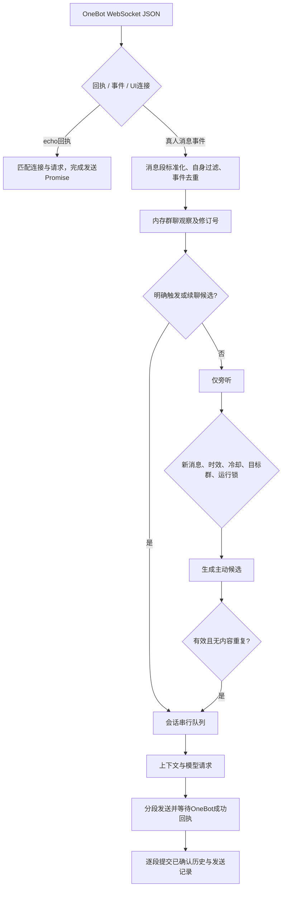

# 消息处理架构

本文介绍 QQ 官方接口及 OneBot 消息的解析、会话调度、主动发言、发送确认和记忆管理。

## 设计原则

- **统一输入**：优先解析结构化消息段，兼容 CQ 字符串，统一处理发送者、引用、图片和触发条件。
- **会话隔离**：同一会话串行执行，不同会话可并行；自动提取的事实仅用于来源会话。
- **事件幂等**：按账号、会话和消息 ID 识别重复事件，排除机器人自身消息。
- **确认后提交**：以 OneBot 成功回执或官方 API 消息 ID 为历史记录的提交依据，保留已确认分段，失败或结果未知时不自动重发。
- **上下文时效**：主动发言基于新增消息进行判断，与普通回复共享冷却，并丢弃过期或重复候选。

## 当前数据流

主动候选的生成本身也占用同一会话队列；图中单独列出是为了展示主动发言的额外判断条件。生成期间明确触发的消息先登记优先权，主动结果会被丢弃，然后处理明确请求。不同会话仍可并行。

### 消息链

`lib/message-chain.js` 的标准化结果包含账号、会话、发送者、群名片、消息 ID、文字、图片来源、@ 列表及引用 ID。数组格式优先；旧 CQ 输入解码转义。表情、语音、视频、转发保留类型标记；语音转写、视频理解和转发展开暂不支持。

触发保留私聊、@ 自身、非空句首关键词和 alwaysReply；增加对已知机器人回复的引用触发。未知引用不会额外请求聊天历史。不会仅因为群友提问就把问题都视为问机器人。

输出文本始终使用 OneBot `text` 段，模型输出中的 CQ 字符串不会自动变成 @全体或图片操作；@ 和生图图片由代码显式构造消息段。图片数据只进入当前模型请求，不写入会话历史，也不留在旁听缓冲。

### 被提及成员

消息解析分别保留用于命令与唤醒词匹配的纯文本，以及用于模型、日志和历史的带对象标记正文。`@` 消息段在原位置转换为 `[@成员 QQ:123]`；机器人与全体成员使用独立标记。多个被提及者保持原始顺序，避免介绍称呼时丢失指代关系。

当前消息、旁听记录及事实提取证据均携带被提及者 QQ 号。模型可结合本群已有成员资料使用群名片或外号；尚无资料时仅保留 QQ 号，不根据未知标记推测昵称。此流程不额外请求群成员列表。模型输出中的对象标记仍是普通文本，不会自动执行 @ 操作。

### 旁听与主动参与

- 观察保留最近 10 分钟、每会话最多 100 条；模型读取条数仍由 proactiveContextSize 控制。
- 按活跃度要求新增非定向消息：热闹 2 条、正常 3 条、冷清 1 条。最近 2 分钟至少 6 条消息且至少 2 人发言视为热闹；少于 3 条视为冷清。
- 同一快照只判断一次，拒绝、解析失败和模型错误也会消费这个快照；后续决策仅处理新增消息。
- 任意已确认回复更新共享冷却。热闹时冷却缩短至基础值的三分之一（基础值较小时不增加），检查间隔最多 15 秒；冷清时冷却至少 120 秒，置信度至少 0.8。正常状态沿用基础配置。底层定时器每 10 秒检查各群是否到期，没有新消息不发起模型判断。
- 生成期间有新真人消息、明确回复任务、关闭主动发言、修改目标群、重启定时器或清除记忆，旧候选不发送。
- 最近已发文本和近期 assistant 历史参与近似文本检查。它是保守的重叠度检查，不等于完整语义理解；命中后丢弃候选，不执行改写重试。
- 模型提示区分新消息、旧背景、引用对象和自己的答复；要求提供新信息，避免机械问候、自我介绍和口头禅。保留用户人设，不添加固定套话。

### 排队与发送

- 每会话最多 20 个明确回复任务，排队超过 2 分钟的任务跳过；模型请求超时 60 秒，SDK 不自动重试。
- 普通回复最多 3 段，每段模拟延迟不超过 1.5 秒；代码块保留完整，不按标点拆散。
- 每段使用唯一 echo，回执必须来自原连接，`status=ok` 且 `retcode=0` 才确认。
- 15 秒无回执、断连或异步未确认状态记作结果未知，不自动重发。明确失败也不写成功历史。
- 第 1 段成功、第 2 段失败时，只保留第 1 段；下一轮能看到实际确认过的内容。
- 超时后的迟到回执不能证明未发送，所以没有自动“补发”。这不是跨进程的 exactly-once 协议；进程崩溃与平台回执丢失仍存在结果不确定的边界。
- 当前进程的 ID 去重窗口为 10 分钟，上限 10000 条。无 ID 输入以内容、发送者和事件时间短期去重 3 秒；它不能完美区分刻意连发与重复投递。
- 已保留历史中的成功输入 ID 也用于重启后的去重。兼容已有历史记录。

### 记忆与重置

模型请求只获得 `role/content`，不会收到本地 messageId、time、kind 等跟踪字段。近期未触发消息作为有明确标签的背景；当前发送者仍是本轮答复对象。

每条成功历史可包含 messageId/messageIds、senderId、time、kind，旧 JSON 无这些字段仍可读取。摘要合并旧摘要，最多保存 4000 字符；用户事实与群内知识来自真人消息；角色自身偏好单独使用已确认助手回复作为证据，不将助手陈述记为群友事实。自动事实按会话去重、每会话最多每分钟提取一次；达到 1000 条后停止新增自动事实，不自动删除已有条目。手动事实（source=manual）可跨会话使用；其他 source 只在对应会话注入；`source=persona` 的角色偏好在会话之间共享。

/reset、/clear、重置记忆、忘记一切：私聊影响本人会话，群聊仅主人有权执行。管理 API 清空/编辑会话会使旧生成与待发分段失效；已经提交到 OneBot 的消息不能撤回。清空短期记忆与清空持久化事实仍为不同操作。

## 成员资料与对话连续性

成员以群会话 ID 与 QQ 号共同标识。开启持久化记忆后，系统记录群名片和明确的称呼，兼容群名片变化；“叫我阿王”“不要叫我老王，叫我阿王就行”等自称与纠正即时更新。“@某成员 以后叫你老猫”可建立有明确对象的外号，不要求额外确认。重名外号不作为唯一身份依据。

成员资料保存在现有持久化记忆文件中，包含 `memberId`、`memberKind`、`value` 和来源消息 `evidenceId`。自动学习复用记忆任务：成功回复或旁听累计到 6 条消息时读取最近最多 12 条真人消息，普通提取每会话最多每分钟一次；明确教学可提前提取，进行中的任务会合并待处理教学快照。结构化偏好和外号必须关联证据消息中的发送者或明确 @ 的成员；引用内容不作为结构化成员事实的来源。每人最多保存 5 个外号、5 条偏好，自动记忆总量沿用 1000 条限制。一般偏好依赖模型判断，不将一次性情绪、反话或调侃直接当作成员特征。

关闭持久化记忆后，不新增或注入成员长期资料，仅使用当前观察窗口中的发送者信息。成员资料可以通过现有持久化记忆管理删除；清空短期会话会结束续聊状态，但不会删除长期成员资料。

普通回复或主动发言收到成功回执后，建立持续 3 分钟的话题参与窗口，每次成功回复刷新时限。窗口内不同成员的非定向文字消息均可进入续聊判断，换人发言不自动结束话题。明确 @ 其他人或引用其他消息的内容保留在旁听上下文；明确 @ 机器人、唤醒词和已知机器人引用仍按直接触发处理。

续聊判断与回复共用一次模型请求，以严格 JSON 返回是否参与。上下文包含近期多人发言、未发送成功的候选消息及机器人已确认回复。单条消息无需回应或结果解析失败时保持沉默，不写入成功历史，也不提前清空话题窗口；是否继续由后续消息判断。只有成功回复延长窗口，闲聊流量本身不无限延长参与时间。

排队中的旧候选如已有更新消息，跳过模型调用；生成或分段等待期间收到新消息则丢弃旧的待发结果。后续候选包含前面的观察记录。续聊回复沿用文本相似度检查，避免重复已发送内容。日志区分进入续聊判断、旁听原因、结果过期、无可发送回复及重复内容。

普通回复与主动发言使用同一份成员资料和群聊表达规则：结合上下文理解梗、反话与情绪，避免机械安慰和强行接梗。角色职业作为背景，仅在话题相关时体现，不自动扩展为职业建议。以上为生成约束，具体理解效果取决于所用模型。

## 话题线索与长期学习

运行时从近期历史整理最多 8 组已确认问答锚点，请求时优先保留引用命中的锚点，最多发送 4 组短线索。每组包含发送者、问题与回答片段及引用匹配；完整近期内容由历史窗口提供。模型优先依据明确引用和说话对象，再结合语义选择相关线索；同时出现的多个话题不默认合并。此实现不增加独立话题分类请求，关联准确度仍取决于模型。

长期记忆沿用原有数据文件与管理 API：成员资料使用 `memberKind`；黑话、教学知识及角色偏好分别使用 `kind=slang/knowledge/bot_preference`，并保存主题与来源证据。黑话需要明确教学或至少两条使用证据，仅在来源群的当前话题包含该词条时注入。教学知识需要明确教学消息。角色偏好需至少两条不同的已确认助手回复表达倾向，不能由群友要求单独建立，也不虚构体验。

记忆页面以长期记忆为默认视图，支持搜索、类型筛选、编辑、启停和分类添加。会话记录单独展示；会话摘要默认折叠，保存旧聊天的压缩上下文，与按条目维护的长期记忆分开存储。后台编辑或手动添加的条目标记为固定，自动学习不覆盖同主题条目；停用条目不进入上下文，也不会被同主题学习重新启用。删除条目后允许后续重新学习；若需持续忽略，应使用停用。修改后点击保存。

### 上下文预算

当前输入、当前图片和人工角色提示保持完整。可选历史使用 16,000 字符预算，裁剪后避免以丢失问题的旧回答开头；不修改磁盘历史。长期记忆最多选择 16 条、约 5,000 字符，优先后台固定资料，再依据词条匹配、中英文词片重合与新近程度排序。无关背景最多保留 3 条；停用资料、其他群或私聊资料不会参与检索，角色共享与人工共享资料保留既有作用域。该实现是本地词面检索，不额外请求模型或向量服务。

旁听背景、成员资料、话题锚点分别使用 4,000、3,000、2,400 字符预算；优先当前发送者及被提及者的资料。预算按 JavaScript 字符长度计算，不等同于模型 Token 上限；超长当前输入仍需由模型服务接受。默认预算集中在 `lib/context-budget.js`。

自动记忆任务的失效范围按会话划分：本群成员纠正会取消本群旧提取，其他群资料变化不影响当前任务；人工编辑长期记忆仍取消所有旧提取。群聊提取必须通过结构化证据校验，不接收缺少成员或知识来源的裸字符串事实。

### 测试会话事务

WebUI 测试使用同一会话队列与重置令牌，生成成功后成对提交用户消息和助手回复。请求失败不写入半轮历史，清空时同步保存历史与摘要删除；生成中或排队中的旧请求失效后返回 HTTP 409。测试会话继续使用 `test_` 前缀，与 QQ 会话隔离。

## 模块职责

| 文件 | 职责 |
| --- | --- |
| `lib/chat-policy.js` | 活跃度参与策略、问答锚点、记忆选择 |
| `lib/context-budget.js` | 历史窗口与可选上下文预算 |
| `lib/test-conversation.js` | WebUI 测试会话的排队、提交与重置 |
| `lib/learned-memory.js` | 黑话、教学知识和角色偏好的证据校验与合并 |
| `lib/group-social.js` | 成员资料、外号、续聊资格与结构化判断结果 |
| `lib/message-chain.js` | 入站消息段和 CQ 兼容解析、身份与触发 |
| `lib/conversation-runtime.js` | 去重、观察水位、共享队列、失效令牌、文本相似度判断 |
| `lib/message-handler.js` | 明确回复事务、图片、摘要裁剪、分段和确认后提交 |
| `lib/proactive.js` | 新消息驱动的候选判断、优先权、时效与冷却 |
| `lib/qq-transport.js` | 消息段输出、echo 回执、失败与未知结果 |
| `lib/chat-completion.js` | 共享上下文组装、事实隔离与模型超时 |
| `lib/memory.js` | 持久化、合并摘要、事实快照与去重 |
| `server.js` | 连接分类、账号检查、回执路由及管理 API 失效处理 |

协议依据：[OneBot WebSocket](https://github.com/botuniverse/onebot-11/blob/master/communication/ws.md)、[消息段](https://github.com/botuniverse/onebot-11/blob/master/message/segment.md)。

## 测试

运行 `npm test` 执行自动化测试，`npm run lint` 执行静态检查，`npm run check:release` 检查发布资源边界。

测试覆盖事件去重、自身消息过滤、消息段解析、引用触发、会话竞争、候选失效、文本相似度、分段顺序、发送回执、会话重置、图片失败、记忆隔离、模型参数传递、成员称呼纠正、资料持久化及续聊退出。集成测试使用独立数据目录、本地模拟模型服务和 WebSocket 客户端验证端到端路由，不依赖真实 QQ 账号或外部模型服务。

## 运行语义

“已确认”表示收到平台成功回执；“结果未知”表示无法确认投递结果，系统不自动重发。主动发言完成一次判断后，需有新增消息满足条件才会再次评估。平台风控、网络延迟及模型输出质量不在本地测试覆盖范围内。

## 渠道适配

NapCat 与 SnowLuma 共用 OneBot 消息链，分别使用反向和正向 WebSocket。官方 QQ Bot 经独立 Webhook 验签与事件标准化后复用会话队列、触发判断、视觉输入和记忆流程；发送绑定原事件与目标 OpenID，避免并发请求使用错误的回复对象。官方身份按应用及环境隔离；OneBot 入站不能自行声明官方身份。切换渠道时关闭旧连接、取消重连并重置运行中的会话令牌，已确认历史保留。官方渠道不参与定时主动发言，避免将 OneBot 的群聊假设应用到官方权限体系。详见 [QQ 渠道配置](./QQ_CHANNELS.md)。
