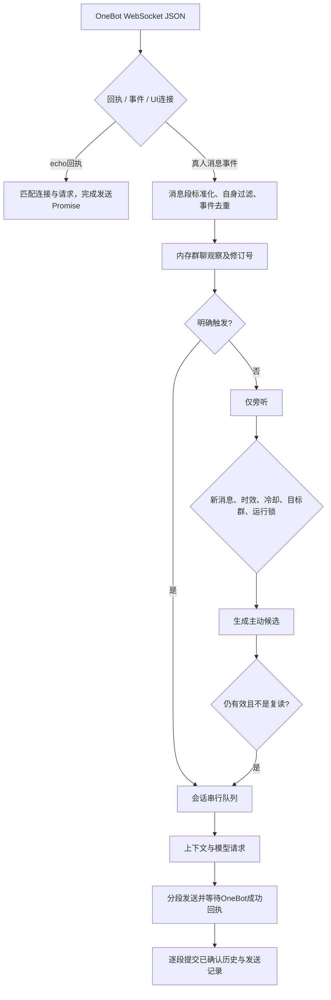

# 群聊消息链与防复读（2026-09-17）

本轮重构只涉及 QQ/OneBot 后端、共享对话与记忆逻辑及测试。桌宠、WebUI 布局、人设配置与本地历史数据不作重置。

## 已确认的旧逻辑问题

| 旧行为 | 后果 | 修复 |
| --- | --- | --- |
| 只从 raw_message 判断 @ 和正文 | 结构化消息没有 raw_message 时漏触发，引用、图片与正文不同步 | 统一解析消息段；CQ 字符串只作为兼容输入 |
| 入口不统一过滤自身消息，也不去重 message_id | 自身回声、多个反向连接重复上报会重复调用模型 | 排除自身及 message_sent；跨连接按账号、会话和消息 ID 去重 |
| 主动检查由 setInterval 启动，没有运行锁 | 慢模型调用跨越下一次定时，多个候选同时发送 | 主动引擎单次运行锁，并复用会话队列 |
| 即时回复不参与主动冷却，也不更新观察进度 | 刚回答完的问题又被当作待回应话题 | 普通回复和主动回复共享发送记录、冷却、观察水位 |
| 非 JSON 主动结果被当作达到阈值的回复 | 模型没有按格式判断，也可能直接发话 | 严格 JSON 判定，解析失败保持安静 |
| 只在主动发送后清空观察窗口 | 无新消息仍反复评估；请求期间的新消息被整批清空 | 每个快照只判断一次；按水位消费，保留后续消息 |
| 分段通过独立 setTimeout 发送 | 队列已处理下一轮，上轮分段仍在发；重置后仍有旧消息 | 延迟、分段及回执全部处于同一个串行任务内 |
| 调用 ws.send 就按成功写历史 | 断连、接口报错、超时也形成虚假的 assistant 记忆 | 等待匹配 echo 的成功回执，再逐段入库 |
| catch 中无条件 pop 历史 | 可能删除已发送回复或其他异步任务写入的记录 | 当前轮先使用快照，确认发送后提交；没有盲目回滚 |
| 生图失败仍写“已生成” | 机器人把不存在的图片当成上下文事实 | 仅图片发送得到成功回执后记录成功 |
| 所有自动事实跨会话注入 | 私聊和其他群的信息串入当前群 | 自动事实按 source 会话隔离；手动条目保留共享语义 |
| 摘要不断追加、事实提取读取可变历史 | 上下文无限增长、角色自己的话被记为用户事实 | 合并旧摘要且限制长度；事实只提取真人陈述快照 |

截图中的相似回复已写入回归用例，验证普通答复之后的近似主动复述会被拦截。不能仅凭截图断言历史每一次复读都由同一个原因导致；上表是代码检查确认的缺口。

## 当前数据流

主动候选的生成本身也占用同一会话队列；图中单独列出是为了展示主动发言的额外判断条件。生成期间明确触发的消息先登记优先权，主动结果会被丢弃，然后处理明确请求。不同会话仍可并行。

### 消息链

`lib/message-chain.js` 的标准化结果包含账号、会话、发送者、群名片、消息 ID、文字、图片来源、@ 列表及引用 ID。数组格式优先；旧 CQ 输入解码转义。表情、语音、视频、转发保留类型标记；尚未实现语音转写、视频理解或转发展开，不能假装读取了这些内容。

触发保留私聊、@ 自身、非空句首关键词和 alwaysReply；增加对已知机器人回复的引用触发。未知引用不会额外请求聊天历史。不会仅因为群友提问就把问题都视为问机器人。

输出文本始终使用 OneBot `text` 段，模型输出中的 CQ 字符串不会自动变成 @全体或图片操作；@ 和生图图片由代码显式构造消息段。图片数据只进入当前模型请求，不写入会话历史，也不留在旁听缓冲。

### 旁听与主动参与

- 观察保留最近 10 分钟、每会话最多 100 条；模型读取条数仍由 proactiveContextSize 控制。
- 每次决策至少需要 3 条尚未消费、未明确触发机器人、也未 @ 其他人的真人消息。
- 同一快照只判断一次，拒绝、解析失败和模型错误也会消费这个快照；不会下一次继续盯着旧话题。
- 任意已确认回复都开启现有 proactiveCooldown；配置为 0 时仍保留新消息、去重与并发约束。
- 生成期间有新真人消息、明确回复任务、关闭主动发言、修改目标群、重启定时器或清除记忆，旧候选不发送。
- 最近已发文本和近期 assistant 历史参与近似文本检查。它是保守的重叠度检查，不等于完整语义理解；宁可少插一句，不通过改写重试绕过拦截。
- 模型提示区分新消息、旧背景、引用对象和自己的答复；要求提供新信息，避免机械问候、自我介绍和口头禅。保留用户人设，不添加固定套话。

### 排队与发送

- 每会话最多 20 个明确回复任务，排队超过 2 分钟的任务跳过；模型请求超时 60 秒，SDK 不自动重试。
- 普通回复最多 3 段，每段模拟延迟不超过 1.5 秒；代码块保留完整，不按标点拆散。
- 每段使用唯一 echo，回执必须来自原连接，`status=ok` 且 `retcode=0` 才确认。
- 15 秒无回执、断连或异步未确认状态记作结果未知，不自动重发。明确失败也不写成功历史。
- 第 1 段成功、第 2 段失败时，只保留第 1 段；下一轮能看到实际确认过的内容。
- 超时后的迟到回执不能证明未发送，所以没有自动“补发”。这不是跨进程的 exactly-once 协议；进程崩溃与平台回执丢失仍存在结果不确定的边界。
- 当前进程的 ID 去重窗口为 10 分钟，上限 10000 条。无 ID 输入以内容、发送者和事件时间短期去重 3 秒；它不能完美区分刻意连发与重复投递。
- 已保留历史中的成功输入 ID 也用于重启后的去重。没有修改或删除用户已有历史。

### 记忆与重置

模型请求只获得 `role/content`，不会收到本地 messageId、time、kind 等跟踪字段。近期未触发消息作为有明确标签的背景；当前发送者仍是本轮答复对象。

每条成功历史可包含 messageId/messageIds、senderId、time、kind，旧 JSON 无这些字段仍可读取。摘要合并旧摘要，最多保存 4000 字符；模型提取事实仅看最近真人陈述，保留人物身份，不从助手表演或推测提取事实。自动事实按会话去重、每会话最多每分钟提取一次；达到 1000 条后停止新增自动事实，不自动删除已有条目。手动事实（source=manual）可跨会话使用；其他 source 只在对应会话注入。

/reset、/clear、重置记忆、忘记一切：私聊影响本人会话，群聊仅主人有权执行。管理 API 清空/编辑会话会使旧生成与待发分段失效；已经提交到 OneBot 的消息不能撤回。清空短期记忆与清空持久化事实仍为不同操作。

## 模块职责

| 文件 | 职责 |
| --- | --- |
| `lib/message-chain.js` | 入站消息段和 CQ 兼容解析、身份与触发 |
| `lib/conversation-runtime.js` | 去重、观察水位、共享队列、失效令牌、近似复读判断 |
| `lib/message-handler.js` | 明确回复事务、图片、摘要裁剪、分段和确认后提交 |
| `lib/proactive.js` | 新消息驱动的候选判断、优先权、时效与冷却 |
| `lib/qq-transport.js` | 消息段输出、echo 回执、失败与未知结果 |
| `lib/chat-completion.js` | 共享上下文组装、事实隔离与模型超时 |
| `lib/memory.js` | 持久化、合并摘要、事实快照与去重 |
| `server.js` | 连接分类、账号检查、回执路由及管理 API 失效处理 |

协议依据：[OneBot WebSocket](https://github.com/botuniverse/onebot-11/blob/master/communication/ws.md)、[消息段](https://github.com/botuniverse/onebot-11/blob/master/message/segment.md)。

## 验证与运行

本轮 `npm test` 共 108 项全部通过，`npm run lint` 通过。发布前可另运行 `npm run check:release`。新增用例覆盖重复事件、自身回声、数组/CQ/引用、普通回复与主动发言竞争、候选过期、复读近似文本、分段顺序、失败/未知回执、重置中断、图片失败、记忆隔离及 temperature=0。

集成测试启动独立数据目录、回环地址上的模拟模型和真实 ws 客户端，验证 server.js 的端到端路由。不连接真实 QQ，不发送真实群消息，不调用付费模型。QQ/NapCat 生产环境的实际风控和延迟仍需运行后观察，模型内容质量也取决于当前人设和所选模型。

升级后重启后端。无需清空配置或群聊记录。日志中的“已确认”表示平台成功回执；“结果未知”表示不要自动补发；“主动发言已被复读检查拦截”表示候选已被丢弃。一次判断后没有新消息而不再发言，是预期行为。
