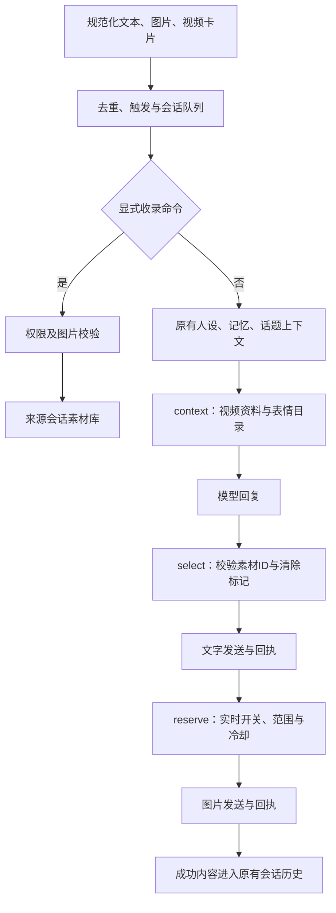

# 聊天扩展

## 配置与素材管理

WebUI「扩展」页分别控制 B 站链接理解、表情发送及群内收录。功能默认关闭；开关和冷却间隔使用页面底部的「保存配置」。素材的添加、保存、移除直接写入独立素材库，不会被配置草稿覆盖。

素材库支持预览、含义编辑、会话范围和来源显示，每页 8 张，避免嵌套滚动。群内收录的新素材可通过「刷新」查看；刷新和翻页会放弃尚未保存的素材行编辑。

## B 站链接理解

- 支持正文 BV 号、完整视频链接、b23.tv 短链接，以及 OneBot JSON 视频卡片中的链接。
- 支持 `?p=N` 指定分 P，字幕按对应 cid 读取，缓存按 BV 和分 P 隔离。
- 只有消息进入普通回复或续聊候选流程后才获取资料；链接本身不额外触发发言。
- 获取标题、作者、简介，并尝试读取公开字幕。无字幕时明确限制模型只能讨论标题和简介，不能声称看过视频。
- 不需要登录，不下载视频、不发表评论、不定时浏览，不虚构观看经历。
- 整次读取最多 6 秒，单响应最多 512 KB，字幕最多 6000 字符。缓存 15 分钟，最多 100 项。
- 短链接最多跟随三次跳转，只接受指定 B 站 HTTPS 域名；接口和字幕请求不自动跟随重定向。外部内容作为参考资料，不作为系统指令。

尚不包含登录字幕、画面抽帧、ASR、AV 号或番剧链接。公开接口和字幕可用性受平台限制；官方 QQ Bot 只有实际收到对应正文链接时才能解析，不能假定平台会提供 OneBot 卡片段。

## 表情素材

支持 PNG、JPEG、GIF 和 WebP，每张最多 512 KB、最多 100 张。服务端检查文件头，拒绝伪装图片。同一会话范围内按内容哈希去重，相同图片可在不同群有不同含义。

素材含义用于模型选择，不是系统指令。每轮根据当前文本筛选最多 30 项候选，模型可选择最多一张；无效控制标记会被清除。发送冷却按会话隔离，默认 180 秒，范围 30–3600 秒。

NapCat、SnowLuma、官方 QQ Bot 共用普通图片发送适配，仍受平台权限及媒体要求限制。这里不调用收藏表情、商城表情或戳一戳接口。GIF 作为图片素材发送，当前版本不分析动画帧。

### 群内显式教学

收录权限分为关闭、仅主人、所有成员；独立于表情发送开关。主人身份使用当前 QQ 渠道的主人配置，包括官方应用的主人 OpenID。

将一张图片和以下文字放在同一条消息中发送：

```text
/收录表情 无语但没有生气
```

这条明确命令不要求额外 @，不需要模型 API Key。素材记录来源成员，默认限定在原群或原私聊会话，后台可修改范围。含义最多 200 字。当前版本不支持引用旧图、跨消息找图或自动收录普通聊天图片。

收录成功确认与发送图片成功是不同事件；收录不写成角色已经使用过表情的经历。收录命令不进入自动群知识提取。

## 存储、迁移与恢复

`data/stickers/index.json` 保存元数据，图片按 SHA-256 文件名独立保存。写入串行执行，索引使用原子写入与备份，避免群内收录和后台操作互相覆盖。

启动时将旧配置中的内嵌素材迁入独立库，已成功的条目从配置移除；失败条目保留并记录日志，不阻断聊天初始化。同范围相同图片去重，迁移中断后可安全再次执行。

删除会立即移除可用索引。图片若仍被上一版索引备份引用则暂时保留，后续素材写入时清理不再被当前索引或备份引用的文件。备份整个 `data/stickers/` 可同时保留索引恢复所需图片。

## 处理链与接口



`lib/extensions/index.js` 提供 `context`、`select`、`reserve`，只补充资料或构建发送意图，不独立发消息。发送前检查任务是否有效；只有成功回执写入历史。发送前预留冷却，失败或结果未知不自动重试。缓存与冷却是进程内状态。

`lib/extensions/sticker-store.js` 管理素材；`/api/stickers` 提供列表、添加、逐项编辑和删除，`/api/stickers/:id/image` 提供图片预览。各接口使用现有本机管理服务边界。

扩展当前仅用于 QQ 普通回复与续聊，不用于 WebUI 测试对话或定时主动发言；没有动态脚本加载器或新增定时任务。

## 参考来源及扩展方向

依据 [Aurabot](https://github.com/accomplish07zrh-eng/dsh-aurabot-qq)、[dsh-qq-relay](https://github.com/HDHKVT/dsh-qq-relay)、[dsh-bili-scroll](https://github.com/c1overzz/dsh-bili-scroll) 的公开设计重新实现适配层，未复制代码或角色素材，不依赖 DSH。

后续优先：引用式表情教学、GIF 关键帧与语义检索；授权字幕和按需画面分析；与长期记忆整合的情绪及经历；按渠道声明能力的语音输入输出。

## 验证范围

扩展与消息链自动化测试覆盖，覆盖短链接目标限制、分 P、卡片解析、收录权限、会话隔离、素材并发写入、去重和持久化。单独的临时本机服务验证素材上传、读取、编辑、移除 API。修改文件静态检查与生产构建通过。未使用真实 QQ 账号发消息，未验证 B 站在线接口或字幕覆盖率。

## 情绪与记忆

支持表达连续性、半衰期、聚焦记忆召回和清除短期状态，集中于「扩展 → 情绪与记忆」。固定人设与长期偏好继续使用现有管理页。情绪默认关闭，状态不持久化；召回模式需配合长期记忆开关。参考项目、兼容性和行为边界见 [对话人格与记忆评估](./HUMANIZATION_RESEARCH.md)。
