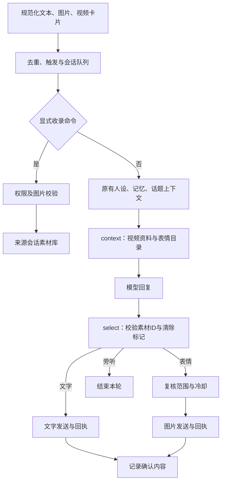

# 聊天扩展

## 配置与素材管理

WebUI「扩展」页提供表情发送、群内教学、NapCat 短语音转写、B 站链接理解与情绪设置。功能默认关闭；开关和冷却间隔使用页面底部的「保存配置」。素材的添加、保存、移除直接写入独立素材库，不会被配置草稿覆盖。

素材库支持按含义、触发例句、会话和教学者查找。点击缩略图旁的「编辑」可维护含义、例句与范围，每页显示 8 张。群内收录的新素材可通过「刷新」查看；刷新和翻页会放弃尚未保存的素材行编辑。

## B 站链接理解

- 支持正文 BV 号、完整视频链接、b23.tv 短链接，以及 OneBot JSON 视频卡片中的链接。
- 支持 `?p=N` 指定分 P，字幕按对应 cid 读取，缓存按 BV 和分 P 隔离。
- 只有消息进入普通回复或续聊候选流程后才获取资料；链接本身不额外触发发言。
- 获取标题、作者、简介，并尝试读取公开字幕。无字幕时明确限制模型只能讨论标题和简介，不能声称看过视频。
- 不需要登录，不下载视频、不发表评论、不定时浏览，不虚构观看经历。
- 整次读取最多 6 秒，单响应最多 512 KB，字幕最多 6000 字符。缓存 15 分钟，最多 100 项。
- 短链接最多跟随三次跳转，只接受指定 B 站 HTTPS 域名；接口和字幕请求不自动跟随重定向。外部内容作为参考资料，不作为系统指令。

尚不包含登录字幕、画面抽帧、ASR、AV 号或番剧链接。公开接口和字幕可用性受平台限制；官方 QQ Bot 只有实际收到对应正文链接时才能解析，不能假定平台会提供 OneBot 卡片段。

## 表情素材

支持 PNG、JPEG、GIF 和 WebP，每张最多 512 KB、最多 100 张。服务端检查文件头，拒绝伪装图片。同一会话范围内按内容哈希去重，相同图片可在不同群有不同含义。

每张图可以填写一个含义和最多 6 条触发例句。例如含义写「表面赞同」，例句写「原则上可以」。例句命中会提高该图进入候选目录的机会，模型结合当前话题决定是否使用。每轮最多提供 30 张候选图。

普通回复、续聊与 OneBot 定时参与共用素材范围和发送冷却。一次判断可选文字、单张表情或旁听。冷却默认 180 秒，范围为 30–3600 秒。图片回执成功后，历史记录该图的含义和消息 ID。

NapCat、SnowLuma、官方 QQ Bot 共用普通图片发送适配，仍受平台权限及媒体要求限制。这里不调用收藏表情、商城表情或戳一戳接口。GIF 作为图片素材发送，当前版本不分析动画帧。

### 群内显式教学

收录权限分为关闭、仅主人、所有成员；独立于表情发送开关。主人身份使用当前 QQ 渠道的主人配置，包括官方应用的主人 OpenID。

将一张图片和以下文字放在同一条消息中发送：

```text
/收录表情 无语但没有生气
```

也可以用 QQ 的回复功能引用一张群友发的图，在同一条回复里写：

```text
风堇，记一下，这张在我们群是“表面赞同”，听到“原则上可以”就用这张
```

自定义角色使用当前角色名或直接 @ 机器人。显式命令和引用教学均检查收录权限，默认把素材限定在来源会话。教学者、原图作者和原消息 ID 可追溯。遇到多图、同时附图和引用、无法取回原图时，可重新随命令发送一张图片。OneBot 支持时会通过当前连接读取引用原消息并核对会话。官方渠道依赖事件提供的引用信息和进程最近观察到的图片。

收录成功确认与发送图片成功是不同事件；收录不写成角色已经使用过表情的经历。收录命令不进入自动群知识提取。

## NapCat 短语音

在「扩展 → 短语音」启用转写，填写兼容 Audio Transcriptions 的模型和接口，再保存配置。接口留空时使用聊天服务的转写路径。同源接口可沿用聊天密钥，其他服务需要独立配置凭据。

每条消息支持一段不超过 60 秒的语音。后端通过当前 NapCat 连接获取 WAV 数据，Docker 部署无需共享音频目录。转写结果随原发言者、@ 和引用进入群聊判断，风堇通过文字或表情回复。

## 存储、迁移与恢复

`data/stickers/index.json` 保存元数据，图片按 SHA-256 文件名独立保存。写入串行执行，索引使用原子写入与备份，避免群内收录和后台操作互相覆盖。

启动时将旧配置中的内嵌素材迁入独立库，已成功的条目从配置移除；失败条目保留并记录日志，不阻断聊天初始化。同范围相同图片去重，迁移中断后可安全再次执行。

删除会立即移除可用索引。图片若仍被上一版索引备份引用则暂时保留，后续素材写入时清理不再被当前索引或备份引用的文件。备份整个 `data/stickers/` 可同时保留索引恢复所需图片。

## 处理链与接口



`lib/extensions/index.js` 提供 `context`、`select`、`reserve`，只补充资料或构建发送意图，不独立发消息。发送前检查任务是否有效；只有成功回执写入历史。发送前预留冷却，失败或结果未知不自动重试。缓存与冷却是进程内状态。

`lib/extensions/sticker-store.js` 管理素材；`/api/stickers` 提供列表、添加、逐项编辑和删除，`/api/stickers/:id/image` 提供图片预览。各接口使用现有本机管理服务边界。

WebUI 多人回放复用群聊消息处理和表情选择，发送结果在页面预览。定时主动参与使用相同的表情目录与会话冷却。

## 参考来源及扩展方向

依据 [Aurabot](https://github.com/accomplish07zrh-eng/dsh-aurabot-qq)、[dsh-qq-relay](https://github.com/HDHKVT/dsh-qq-relay)、[dsh-bili-scroll](https://github.com/c1overzz/dsh-bili-scroll) 的公开设计重新实现适配层，未复制代码或角色素材，不依赖 DSH。

后续可扩展 GIF 关键帧检索、授权字幕、视频画面理解及语音输出。

## 验证范围

自动化测试覆盖视频分 P 与卡片解析、表情收录权限与来源、素材去重及持久化、语音格式和转写凭据隔离。管理接口测试在临时数据目录运行，通过本机模拟服务验证素材增删改查与 QQ 回执。

## 情绪与记忆

支持表达连续性、半衰期、聚焦记忆召回和清除短期状态，集中于「扩展 → 情绪与记忆」。固定人设与长期偏好继续使用现有管理页。情绪默认关闭，状态不持久化；召回模式需配合长期记忆开关。参考项目、兼容性和行为边界见 [对话人格与记忆评估](./HUMANIZATION_RESEARCH.md)。
